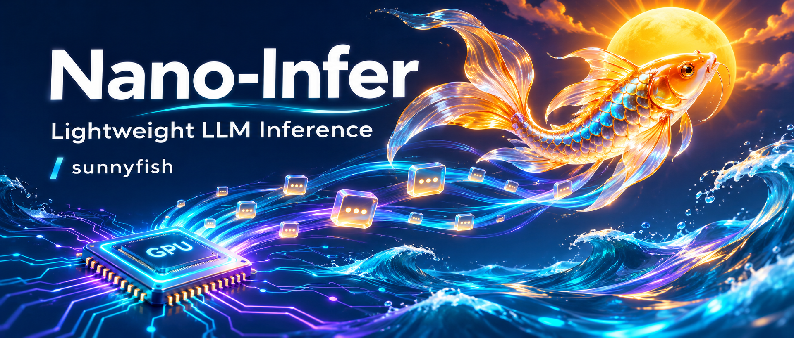

<p align="center">
  
</p>
<h1 align="center">Nano Infer</h1>
<p align="center">面向 Qwen3 与 Qwen3.5 的轻量推理引擎</p>
<p align="center">
  <a href="pyproject.toml"></a>
  <a href="LICENSE"></a>
</p>

Nano Infer 基于 [nano-vLLM](https://github.com/GeeeekExplorer/nano-vllm) 扩展，提供简洁的离线 Python API，方便运行模型、阅读源码和研究推理机制。

## 特性

- **模型适配**：Qwen3 Dense、Qwen3 MoE 与 Qwen3.5 Dense。
- **缓存与调度**：分页 KV cache、分块预填充，以及 Qwen3.5 的 KV/GDN 联合前缀复用。
- **多模态输入**：Qwen3.5 支持文本、图片和本地视频，统一生成文本。
- **执行优化**：FlashAttention、Triton、CUDA Graph，以及实验性纯文本 MTP 投机解码。

## 模型支持

| 模型 | 输入 | 当前范围 |
| --- | --- | --- |
| Qwen3 Dense | 文本 | eager / Decode Graph；TP 已接入，完整模型多卡待验证 |
| Qwen3 MoE | 文本 | 实验性适配，使用 eager；真实权重待验证 |
| Qwen3.5 Dense | 文本、图片、视频 | 单 GPU；可选阶段 Graph 和纯文本 MTP |

当前为同步、离线推理。Qwen3.5 MoE、Qwen3.5 TP 和 EP 尚未实现；同系列其他 checkpoint 仍需单独验证。

## 安装

需要 **Linux / WSL2、NVIDIA CUDA GPU、Python 3.10–3.12**。先准备匹配的 [PyTorch CUDA / torchvision](https://pytorch.org/get-started/locally/) 环境，并满足 [FlashAttention 安装要求](https://github.com/Dao-AILab/flash-attention#installation-and-features)。以下命令在已激活的 Python 环境中执行：

```bash
git clone https://github.com/SunnyFish333/nano-infer.git
cd nano-infer
python -m pip install packaging ninja psutil
python -m pip install -r requirements.txt --no-build-isolation
python -m pip install --no-deps -e .
```

包名和导入名均为 `nanoinfer`。运行依赖与版本范围见 [pyproject.toml](pyproject.toml)。

## 快速开始

准备完整的本地 Hugging Face 模型目录，包括权重、tokenizer 和 Processor 配置。以 Qwen3.5-0.8B 为例：

```bash
python -m pip install huggingface_hub
hf download Qwen/Qwen3.5-0.8B --local-dir "$HOME/huggingface/Qwen3.5-0.8B"
python example_qwen3_5.py --question '请用一句话解释 KV cache。'
```

已有模型可用 `--model /path/to/model` 指定路径。引擎读取本地文件，不直接接受 Hub 模型 ID。

### Python API

```python
from pathlib import Path
from nanoinfer import LLM, SamplingParams

llm = LLM(
    str(Path("~/huggingface/Qwen3.5-0.8B").expanduser()),
    enforce_eager=True,
    max_model_len=1024,
    max_num_batched_tokens=256,
    max_num_seqs=1,
    gpu_memory_utilization=0.7,
)
try:
    prompt = {"messages": [{"role": "user", "content": "请用一句话解释 KV cache。"}]}
    outputs = llm.generate([prompt], SamplingParams(temperature=0, max_tokens=64))
    print(outputs[0]["text"])
finally:
    llm.exit()
```

`generate()` 返回与输入顺序一致的结果，每项含 `text` 和 `token_ids`。`temperature=0` 使用 greedy，正值使用温度采样。完整配置见 [Config](nanoinfer/config.py)。

## 示例

| 入口 | 用途 |
| --- | --- |
| [example_qwen3.py](example_qwen3.py) | Qwen3-0.6B 的聊天模板、批量生成与基础 API |
| [example_qwen3_5.py](example_qwen3_5.py) | Qwen3.5 的文本、图片、视频、MTP 和 Graph |

```bash
# 图片或本地视频
python example_qwen3_5.py --mode image --image ./demo.jpg --question '图片里是什么？'
python example_qwen3_5.py --mode video --video ./demo.mp4 --question '描述视频内容'

# 纯文本 MTP + 阶段 Graph，需要完整 MTP 权重
python example_qwen3_5.py --mtp --speculative-tokens 2 --cuda-graph --temperature 0

# Qwen3 基础示例，需准备 ~/huggingface/Qwen3-0.6B
python example_qwen3.py
```

运行 `python example_qwen3_5.py --help` 查看全部示例参数。MTP 默认关闭，收益取决于负载；Graph 会增加捕获开销。显存不足时，先降低上下文长度、批量或媒体输入大小。

## 许可与致谢

由 [SunnyFish333](https://github.com/SunnyFish333) 维护，采用 [MIT License](LICENSE)。基于 [nano-vLLM](https://github.com/GeeeekExplorer/nano-vllm) 开发，保留原作者版权声明。感谢 Qwen、PyTorch、Triton、FlashAttention 与 Hugging Face 社区。
