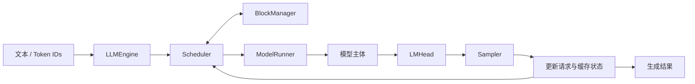

<!-- The logo belongs to the upstream Nano-vLLM project. -->
<p align="center">
  
</p>

<h1 align="center">Nano-vLLM · Multi-Model</h1>

<p align="center">
  <strong>让更多模型接入同一套轻量推理引擎。</strong><br>
  面向多模型适配的轻量级 LLM 推理项目，以 Qwen3 Dense 为基线，首个 MoE 扩展目标为 Qwen3-30B-A3B。
</p>

<p align="center">
  <a href="LICENSE"></a>
  <a href="pyproject.toml"></a>
  <a href="#models"></a>
  <a href="#roadmap"></a>
</p>

<p align="center">
  <a href="#about">项目定位</a> ·
  <a href="#models">模型状态</a> ·
  <a href="#quickstart">快速开始</a> ·
  <a href="#architecture">架构</a> ·
  <a href="#roadmap">路线图</a> ·
  <a href="#contributing">参与贡献</a>
</p>

> **当前进度**：已注册 Qwen3 Dense 与 Qwen3 MoE，并实现 MoE Router 与逐专家计算；正在为 Qwen3.5 准备 Partial RoPE、交错 MRoPE 与 Norm 组件。Qwen3-30B-A3B 尚未完成运行与数值验收，Qwen3.5 尚未接入完整推理链路。下方快速开始使用 Qwen3-0.6B。

<a id="about"></a>

## 为什么做这个项目？

本项目基于 [GeeeekExplorer/nano-vllm](https://github.com/GeeeekExplorer/nano-vllm)，目标是保留小型推理引擎的可读性，逐步建立能够承载不同模型架构的执行路径。

一次模型适配应覆盖完整链路：**结构配置 → 权重加载 → 前向计算 → KV Cache → 批量调度 → 数值对齐 → 性能验证**。首个扩展目标选择 Qwen3-30B-A3B，用它打通从 Dense MLP 到 MoE 路由与专家计算的工程路径。

- **面向扩展**：逐步解耦模型选择、模型专属结构与通用引擎，让新增架构有清晰的接入位置。
- **贴近执行**：直接阅读 token 打包、缓存地址映射、张量并行和 GPU kernel 的调用过程。
- **正确性优先**：先验证权重与 logits，再验证带缓存的生成，最后比较性能。
- **面向工程实践**：围绕模型适配、算子优化和性能分析，提供清晰的实现与验证路径。

<a id="models"></a>

## 模型与能力状态

### 模型矩阵

| 模型 | 架构 | 当前状态 | 说明 |
| --- | --- | --- | --- |
| Qwen3-0.6B | Dense / GQA | 已有代码与示例入口 | 当前回归基线；本分支 GPU 验收待补充 |
| Qwen3-30B-A3B | MoE / GQA | 模型结构与注册已接入，待运行验证 | 完整权重加载、生成与数值对齐待验证 |
| Qwen3.5 Dense / MoE | 混合注意力 / 视觉语言模型 | 基础组件准备中 | 已新增位置编码与 Norm 组件；模型、视觉输入和状态缓存尚未接入 |
| 其他模型 | 按架构扩展 | 后续规划 | 完成结构和权重审计后，再加入支持矩阵 |

“已有代码”表示存在相应实现；只有提交可复现的数值和运行记录后，才标记为验证通过。同属 Qwen 系列，也不代表只替换模型路径即可运行。

### 当前引擎已包含的机制

| 能力 | 当前实现 |
| --- | --- |
| 离线批量生成 | `LLM.generate()`，支持字符串或 token ID 输入 |
| 分页 KV Cache | 块分配、引用计数、缓存复用与失效处理 |
| 前缀缓存 | 通过完整块哈希查找可复用前缀 |
| Chunked Prefill | 支持分块；每轮仅首个选中请求允许部分处理 |
| 请求调度 | Prefill 优先；单轮选择 Prefill 或 Decode |
| 张量并行 | 单机多进程 TP，按层进行分片与通信 |
| Attention | FlashAttention 与 Triton KV 写入内核 |
| CUDA Graph | 满足条件的 Decode 模型主体前向 |
| 合并计算 | QKV、gate/up 投影合并，以及部分算子的 `torch.compile` |

MoE 已有模型实现，尚未作为验证通过的可用模型提供。EP、量化、投机解码、PD 分离和 HTTP 服务尚未实现。

### MoE 接入进度与限制

- **统一入口**：`ModelRunner` 已调用 `registry.build_model(hf_config)`；注册表已启用 `qwen3` 与 `qwen3_moe`，根据模型配置选择对应架构。
- **模型结构**：已实现 MoE Attention、按层选择 Dense / MoE、Top-K 路由、选中权重归一化，以及逐专家计算和输出累加。
- **权重路径**：模型采用逐专家 `ModuleList`，通过 `packed_modules_mapping` 复用现有 loader 的 QKV 与 gate/up 合并加载机制；真实 checkpoint 的完整加载仍需验证。
- **执行模式**：当前路由包含依赖输入的 `nonzero()`、`.item()` 与 Python 循环，首次运行需设置 `enforce_eager=True`，尚未支持现有 CUDA Graph 捕获路径。
- **并行方式**：Attention 和专家线性层复用 TP，Router 在各 rank 保留完整权重；当前属于 TP 实现，不包含 EP。目标模型有 4 个 KV heads，现有分片约束下 TP 候选值为 1、2、4，多卡运行尚待验证。
- **验收待办**：验证模型创建、真实权重加载、Prefill / Decode logits、完整生成和缓存路径，再进行 TP 与性能验收。

当前实现面向目标模型的 Top-8 与路由权重归一化配置；拓展到其他 MoE 配置前，还需处理 `top_k=1` 时 mask 的维度，以及按 `norm_topk_prob` 配置决定是否归一化。

### Qwen3.5 基础组件进度

以下为已添加的底层代码，尚未完成数值对齐，也不代表已经支持 Qwen3.5 生成：

| 组件 | 当前实现 | 接入状态 |
| --- | --- | --- |
| Partial RoPE | `apply_rotary_emb()` 旋转前 `rotary_dim` 维，其余维度保留；普通 RoPE 允许旋转维度小于 head 维度 | 现有 Qwen3 模型仍传入完整 head 维度 |
| 交错 MRoPE | `MRotaryEmbedding` 接收 `[3, N]` 的 T/H/W 位置，通过轴选择表和 `gather` 为各频率选择角度，再旋转 Q/K | 尚未接入模型；`get_rope()` 仍创建普通 RoPE |
| 零中心 RMSNorm | `GemmaRMSNorm` 使用 `1 + weight` 缩放，权重初始化为零 | 已添加，待模型接入与精度验证 |
| 门控 RMSNorm | `RMSNormGated` 在归一化与权重缩放后乘以 `SiLU(gate)` | 已添加，待 Gated DeltaNet 接入 |

MRoPE 默认频率分配为 `(11, 11, 10)`，对应 64 个旋转维度；当前交错切片逻辑仍需补充参数校验和其他配置的覆盖验证。后续还需要实现 Gated DeltaNet 及其卷积/递推状态缓存、Gated Attention、模型配置与权重映射，以及图像/视频预处理、视觉编码器和多模态位置编号生成。

### 首个 MoE 目标：Qwen3-30B-A3B

目标 checkpoint 为原始的 [`Qwen/Qwen3-30B-A3B`](https://huggingface.co/Qwen/Qwen3-30B-A3B)，其[官方配置](https://huggingface.co/Qwen/Qwen3-30B-A3B/blob/main/config.json)包含：

| 项目 | 配置 |
| --- | --- |
| 模型类型 | `qwen3_moe` / `Qwen3MoeForCausalLM` |
| 参数规模 | 约 30.5B 总参数，约 3.3B 激活参数 |
| Transformer 层数 | 48 |
| 隐藏维度 | 2048 |
| Attention | 32 个 Q heads、4 个 KV heads、head dim 128 |
| 专家路由 | 每个 MoE 层 128 个专家，每个 token 选择 8 个 |
| 专家中间维度 | 768 |

**A3B 描述每个 token 的激活参数规模，不代表只需要加载约 3B 权重。** 按 30.5B 参数、每参数 2 字节粗略估算，BF16 权重约为 61 GB（约 56.8 GiB）；实际推理还需要 KV Cache、激活和运行时空间。首版以浮点权重的正确执行为目标，量化和 EP 分阶段推进。

<a id="quickstart"></a>

## 快速开始

以下命令面向**当前 Qwen3 Dense 基线**，在仓库根目录执行。

### 1. 准备环境

- Python **3.10–3.12**。
- Linux、NVIDIA GPU，以及兼容的 CUDA / 驱动环境。
- 当前依赖声明包含 PyTorch `>=2.4.0`、Transformers `>=4.51.0`、Triton 和 FlashAttention。
- 先按照 [PyTorch 官方说明](https://pytorch.org/get-started/locally/)安装与你的设备匹配的 CUDA 版本，并确认 `torch.cuda.is_available()` 为 `True`。FlashAttention 的具体 GPU、CUDA 与构建要求以其[官方安装说明](https://github.com/Dao-AILab/flash-attention#installation-and-features)为准。

```bash
# 在已安装 CUDA 版 PyTorch 的 Python 环境中执行
python -m pip install --upgrade pip
python -m pip install packaging ninja
python -m pip install flash-attn --no-build-isolation
python -m pip install -e .
python -m pip install huggingface_hub
```

GPU 路径使用 CUDA、Triton、FlashAttention 与 NCCL；Windows 原生和 CPU 推理不属于当前运行基线。依赖使用版本下限声明，尚未提供锁定版本的环境复现文件。

### 2. 下载基线模型

```bash
hf download Qwen/Qwen3-0.6B \
  --local-dir "$HOME/huggingface/Qwen3-0.6B"
```

模型目录必须包含配置、分词器和权重文件。下载命令使用 Hugging Face 官方 [`hf` CLI](https://huggingface.co/docs/huggingface_hub/guides/cli)。

### 3. 运行示例

```bash
python example.py
```

`example.py` 默认从 `~/huggingface/Qwen3-0.6B/` 加载模型，并对两个独立问题进行批量生成。

API 示例：

```python
import os

from nanovllm import LLM, SamplingParams
from transformers import AutoTokenizer


def main():
    model_path = os.path.expanduser("~/huggingface/Qwen3-0.6B/")
    tokenizer = AutoTokenizer.from_pretrained(model_path)
    llm = LLM(model_path, enforce_eager=True, tensor_parallel_size=1)

    prompts = [
        tokenizer.apply_chat_template(
            [{"role": "user", "content": "用三句话解释 KV Cache。"}],
            tokenize=False,
            add_generation_prompt=True,
            enable_thinking=False,
        )
    ]
    outputs = llm.generate(
        prompts,
        SamplingParams(temperature=0.6, max_tokens=128),
    )
    print(outputs[0]["text"])


if __name__ == "__main__":
    main()
```

每个输出包含 `text` 和 `token_ids`。当前采样器要求 `temperature > 1e-10`，不提供 `temperature=0` 的贪心模式；多进程入口保留 `__main__` 保护。

<a id="architecture"></a>

## 从请求到 GPU



- **Engine** 管理请求入口、生成循环和结果收集。
- **Scheduler** 决定本轮计算哪些 token，处理分块 Prefill 与缓存不足时的抢占。
- **BlockManager** 管理缓存块的归属、共享、释放和前缀哈希。
- **ModelRunner** 准备 GPU 输入、分配实际 KV 存储、执行模型与采样，并协调 TP 进程。
- **Models / Layers** 定义具体架构以及可复用的计算模块。

`ModelRunner` 通过 `build_model(hf_config)` 查询模型注册表，根据 `hf_config.model_type` 创建模型。新增架构通过注册表接入，统一提供 `forward()` 与 `compute_logits()` 接口；未知模型类型会给出明确错误。

### 当前目录

```text
nano-vllm/
├── example.py                 # 离线生成示例
├── bench.py                   # 批量生成吞吐量测试
└── nanovllm/
    ├── llm.py                 # 公共 LLM 入口
    ├── config.py              # 引擎配置与 HF 配置读取
    ├── sampling_params.py     # 每个请求的采样参数
    ├── models/
    │   ├── registry.py        # 根据 model_type 选择模型实现
    │   ├── qwen3.py           # Dense Qwen3 架构
    │   └── qwen3_moe.py       # Qwen3 MoE 架构，已注册，待运行验收
    ├── layers/
    │   ├── rotary_embedding.py # RoPE、Partial RoPE 与交错 MRoPE 组件
    │   ├── layernorm.py       # RMSNorm、零中心与门控 Norm 组件
    │   └── ...               # 并行线性层、Attention、激活与采样等
    ├── engine/
    │   ├── llm_engine.py      # 请求生命周期
    │   ├── sequence.py        # 序列状态
    │   ├── scheduler.py       # 调度与抢占
    │   ├── block_manager.py   # KV 块管理与前缀复用
    │   └── model_runner.py    # GPU 执行、TP 协调与 CUDA Graph
    └── utils/                 # 权重加载与执行上下文
```

## 如何接入一个模型？

新增模型以以下验收链路为准：

1. **审计配置与权重**：确认 `model_type`、层类型、参数名称、形状和共享关系。
2. **实现架构并接入选择入口**：复用通用层，实现目标模型的 `forward()` 和 `compute_logits()`。
3. **完成权重加载**：覆盖合并投影、分片及模型专属参数，明确处理缺失或未知权重。
4. **检查缓存兼容性**：确认现有 KV 布局、前缀复用和抢占恢复是否适用。
5. **验证数值**：对齐参考实现的 logits，分别验证 Prefill、Decode、批量和分块路径。
6. **验证并行与性能**：单卡正确后，再推进 TP、CUDA Graph 和算子优化。

新增 Attention、激活或专家模块时扩展 `layers/`；只有输入、缓存或执行协议发生变化时，才进一步修改引擎。模型支持列表随实际验收结果更新。

<a id="roadmap"></a>

## Roadmap

### 已有基础

- [x] Qwen3 Dense 模型结构与权重加载路径
- [x] 批量生成、分页 KV、前缀缓存与抢占恢复代码
- [x] Chunked Prefill、单机 TP 与 Decode CUDA Graph 路径

### 第一阶段：多模型入口与 Qwen3-30B-A3B 正确执行

- [x] 按模型配置注册和选择实现，替换固定的 Qwen3 构造入口
- [x] 启用 `qwen3_moe` 注册项
- [ ] 验证 MoE 模型创建与真实 checkpoint 加载
- [ ] 保持 Dense Qwen3 的生成回归
- [x] 实现 MoE Router、Top-8 路由权重归一化、专家执行与输出合并
- [ ] 验证现有 loader 对 Router 与逐专家 checkpoint 权重的完整加载
- [ ] 完成单卡浮点 Prefill / Decode，与参考实现对齐
- [ ] 验证批量、Chunked Prefill、前缀缓存与抢占恢复

### 第二阶段：并行与效率

- [x] 在代码中复用 Attention / 专家线性层 TP，Router 保持完整副本
- [ ] 验证多卡数值与通信正确性
- [ ] 评估 MoE dispatch、Grouped GEMM 与融合计算
- [ ] 验证 MoE 执行路径的 CUDA Graph 兼容性
- [ ] 发布完整环境、输入配置与基准结果

### 后续方向

- [x] 添加 Partial RoPE、交错 MRoPE、零中心 RMSNorm 与门控 RMSNorm 组件
- [ ] 完成位置编码与 Norm 的参考实现数值对齐及边界检查
- [ ] 接入 Qwen3.5 混合注意力语言骨干与状态缓存
- [ ] 接入 Qwen3.5 视觉编码、图像/视频输入和多模态位置编号
- [ ] 完成 Qwen3.5 Dense / MoE 权重加载、生成及缓存路径验证
- [ ] 更多 Dense / MoE 架构
- [ ] Expert Parallelism 与跨卡 token dispatch / combine
- [ ] 权重量化、激活量化与专用计算内核
- [ ] 投机解码与候选缓存管理
- [ ] 在线服务入口与延迟评测

<a id="benchmark"></a>

## Benchmark

### GPU 批量生成基准

准备好基线模型和 CUDA 环境后：

```bash
python bench.py
```

当前脚本构造 256 个请求，输入和输出长度分别随机取 100–1024 token，先预热，再统计 **输出 token 总数 / 整批生成耗时**。这不是单请求 Decode 速度，也不包含模型加载时间。

Qwen3-30B-A3B 的性能数据将在适配与数值验证完成后发布。上游仓库的历史 Dense 基准请见[原项目](https://github.com/GeeeekExplorer/nano-vllm#benchmark)，本分支的 MoE 性能需要单独测量。

提交性能结果时，请附上：commit、模型版本与精度、GPU 型号和数量、依赖版本、TP / EP 配置、输入输出长度、并发或批量、预热方式，以及适用的吞吐量和延迟指标。当前 `bench.py` 只提供批量吞吐量；TTFT / ITL 等服务指标需要额外评测入口。

<a id="contributing"></a>

## 参与贡献

欢迎提交模型适配、数值验证、性能优化和文档改进。

- **模型适配**：说明目标 checkpoint、结构差异、权重映射及可复现运行方式。
- **正确性改进**：提供触发输入、预期与实际结果，以及必要的回归检查。
- **性能优化**：同时提供数值正确性检查、环境信息和相同负载下的前后对比。
- **文档改进**：区分已经实现、已经验证与后续规划，确保示例对应当前 API。

建议按“模型接入 → 数值验证 → 并行 → 性能优化”拆分改动，使每一步都便于检查和复现。

## 致谢与许可证

- [Nano-vLLM](https://github.com/GeeeekExplorer/nano-vllm)：原始推理引擎与核心实现。
- [Qwen](https://github.com/QwenLM/Qwen3)：模型、配置与参考资料。
- [vLLM](https://github.com/vllm-project/vllm)、[FlashAttention](https://github.com/Dao-AILab/flash-attention)、[Triton](https://github.com/triton-lang/triton)：推理系统与高效 GPU 计算相关项目。

本仓库代码沿用 [MIT License](LICENSE)，保留上游版权声明。模型权重遵循对应模型仓库的许可证；Qwen3-30B-A3B 的许可证见其[官方模型卡](https://huggingface.co/Qwen/Qwen3-30B-A3B)。
